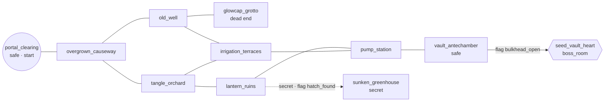

# Region 1 — Paper Design

> **Status: Reviewed by owner 2026-11-01 — decisions in §9.** Issue [#14](https://github.com/mcastrucci/idle-rpg-adventure/issues/14).
> All names are **working names**; the owner reviews creative choices. Lore stays within
> [`concept.md`](../concept.md) §2. Every number is **provisional** and is meant as input to `balance-sim` (#24) and
> the M1 balance pass ([open decision #2](../open-decisions.md)). No content JSON, code or art comes from this doc
> directly. Content is authored later in #45/#46 against `@rpg/rpg-schema`.

## 0. Modelling assumptions (for the arithmetic in this doc only)

The numbers below were checked with a rough Monte Carlo script outside the repo. That script is **not** the real
`rpg-sim`. These assumptions belong to other issues. If those issues land different values, re-derive the numbers here;
they are not decisions.

| # | Assumption | Owner |
|---|---|---|
| A1 | Tick = 500 ms; every actor in Region 1 acts every **5 ticks** (no haste gear in R1). Haste −1 tick per 25 points, floor 2 | #20, open decision #1 |
| A2 | `ARMOR_K = 200` (physical vs `armor`, magic vs `resist`); `CRIT_MULT_BP = 15000` | #20, open decision #2 |
| A3 | Hero derived stats: `maxHp = 40 + 6·VIT + 6·level + gear`; `power = STR + weapon`; `armor = VIT/3 + gear`; `resist = SPI/3 + gear`; `critBp = 200 + 50·AGI + gear`; `healPower = 2·SPI` | #19 |
| A4 | Attribute points: 30 at level 1, +4 per level | #19, open decision #13 |
| A5 | 4 active skill slots plus an always-available `skill:basic_attack` | open decision #13 |
| A6 | `heal`/`hot` coefficients scale on the caster's `healPower` for skills and on the user's `maxHp` for **consumables** | #21 (see Q-B3) |
| A7 | A self buff with unit `attacks` is consumed by each attack that **hits its owner** (taunt: attacks by the taunted enemy) | #21 (see Q-B4) |
| A8 | A manual input is queued and runs at the hero's **next ready tick**; there is no off-cooldown instant action | #20/#22 (see Q-B5) |
| A9 | Idle between-encounter regen: **15% maxHp**. Live out-of-combat regen: 1% maxHp per tick outside combat; full rest at `safe` locations | open decision #16 |
| A10 | Live spawns: **2 encounter rolls per combat location per instance**, no respawn | open decision #14 |

## 1. Theme & fantasy

| Aspect | Design |
|---|---|
| Working name | **The Verdant Hollow** (area ID `area:region_1`; the ID stays neutral so a rename never touches IDs) |
| Fragment | The fragment closest to Sanctuary. One of the Ark's agricultural modules (seed vault, terraced hydroponics, pump station) is fused with an alien forest that came through the Fracture. Ark alloy and alien roots grow into each other. |
| Tone | Melancholic, overgrown, quiet. Danger comes in short bursts: it is a garden gone feral, not a war zone. Teal bioluminescence against rust and amber sap. |
| Tech-as-magic | Maintenance drones read as "lantern spirits". Agricultural automatons are "Tillers", believed to be cursed ploughmen. The pump station's hum is a "heartbeat". Ancient inscriptions are Ark signage that nobody can read any more. |
| Difficulty | `difficulty: 1`, `recommendedLevel: [1, 5]`, mini-boss level 6 |

**Narrative hook.** Sanctuary's cisterns are running dry. Their water has always come up through an "old well" that the
founders sealed behind a portal, and the flow is now a trickle. The Keepers of Sanctuary (working name) send the hero
through the portal to find out why. On the other side they find the Hollow: a drowned garden where something has rooted
itself into the great pump that feeds Sanctuary. That something is the **Hollow Matriarch**, an Ark caretaker frame
that the alien root network has taken over. It now "protects" the pump by strangling it. Defeating it brings water back
to Sanctuary and conquers the region. It also leaves open questions: who built the vault, and why does the root network
seem to listen to signals coming from deeper in the Fracture?

## 2. Location graph

11 locations: 8 in the conquest pool (`ordinary`), plus a `safe` start location, a secret location and a boss room.

| ID (`loc:region_1.*`) | Tags | Pool | Level | Description | Encounters (`enc:region_1.*`) | Resources | Hotspots |
|---|---|---|---|---|---|---|---|
| `portal_clearing` | `safe` (start) | no | — | Portal arch out of Sanctuary; a dead campfire; first view of the overgrowth | — | — | `portal_glyphs` (lore) |
| `overgrown_causeway` | `ordinary` | yes | 1–2 | Raised Ark walkway swallowed by moss | `causeway` | `res:glowcap` | `fallen_sign` (lore) |
| `old_well` | `ordinary` | yes | 2–3 | Coolant intake shaft that locals call a well; it goes down into the dark | `old_well` | `res:glowcap` | `inscription` (lore) |
| `tangle_orchard` | `ordinary` | yes | 2–3 | Feral fruit trees that grew from Ark seed stock, full of boars | `orchard` | `res:resin_tap` | `grafted_tree` (lore) |
| `glowcap_grotto` | `ordinary`, dead end | yes | 1–3 | Collapsed cistern lit by fungus; optional dead end | `grotto` | `res:glowcap` ×2 | `mushroom_ring` (search, cosmetic lore) |
| `lantern_ruins` | `ordinary` | yes | 3 | Drone maintenance bay; "lantern spirits" circle the wreckage | `lantern_ruins` | `res:alloy_scrap` | `cracked_panel` (search: sets flag `region_1.hatch_found`) |
| `irrigation_terraces` | `ordinary` | yes | 3–4 | Stepped hydroponic beds; Tillers still plough dead soil | `terraces` | `res:resin_tap` | `valve_chart` (lore) |
| `pump_station` | `ordinary` | yes | 4 | The "heartbeat" machine hall; roots coil around the pipes | `pump_station` | `res:alloy_scrap` | `bulkhead_lever` (interact: sets flag `region_1.bulkhead_open`) |
| `vault_antechamber` | `ordinary`, `safe` | yes | — | Sealed airlock where an Ark beacon still repels creatures; the last rest before the boss | — | — | `beacon` (lore: Matriarch warning) |
| `sunken_greenhouse` | `secret` | no | 5 | Flooded greenhouse under the ruins; the hardest fight in the region and the best cache | `greenhouse` | `res:seed_cache` | `founder_log` (lore) |
| `seed_vault_heart` | `boss_room` | no | 6 | Vault core with the Matriarch rooted into the pump | `matriarch` | — | — |

**Exits** (all bidirectional unless noted):

| Exit | Requires | Tags |
|---|---|---|
| portal_clearing ↔ overgrown_causeway | — | — |
| overgrown_causeway ↔ old_well | — | — |
| overgrown_causeway ↔ tangle_orchard | — | — |
| old_well ↔ glowcap_grotto | — | — |
| old_well ↔ irrigation_terraces | — | — |
| tangle_orchard ↔ lantern_ruins | — | — |
| tangle_orchard ↔ irrigation_terraces | — | — |
| lantern_ruins ↔ pump_station | — | — |
| irrigation_terraces ↔ pump_station | — | — |
| pump_station ↔ vault_antechamber | — | — |
| vault_antechamber → seed_vault_heart | `{ "flag": "region_1.bulkhead_open" }` | — |
| lantern_ruins ↔ sunken_greenhouse | `{ "flag": "region_1.hatch_found" }` | `secret` |



**Completion rule** (engine `CompletionRule`):

```json
{
  "pool": { "tag": "ordinary" },
  "thresholdBp": 7000,
  "required": { "all": [{ "game": "defeated", "enemy": "enemy:hollow_matriarch" }] },
  "frozen": { "poolSize": 8, "requiredCount": 6, "at": "<publish date>" }
}
```

- `requiredCount = ceil(8 × 7000 / 10000) = ceil(5.6) = 6`.
- Feasibility: all 8 pool locations are reachable without the secret exit. The shortest route to the boss (causeway →
  orchard or terraces → pump → antechamber) discovers 4–5 pool locations, so conquest asks for **1–2 detours**. This is
  intended: conquest rewards some exploration without demanding a full clear.
- Secret `sunken_greenhouse` and boss room are outside the pool; secret is never shown as "missing" (conquest-rules §5).
- Optional dead end: `glowcap_grotto` (in pool, but never required).

## 3. Enemies

All IDs are `enemy:*`; skills are `skill:*`. "TTK" is the median hero-side time-to-kill in ticks, taken from §7.

### 3.1 Commons

| ID | Lvl | Role | Stats (maxHp / power / armor / resist) | Skills | AI (priority) | XP | Gold |
|---|---|---|---|---|---|---|---|
| `glowcap_mite` | 1 | Swarm fodder in packs of 2–3; rewards `cleave` | 22 / 5 / 0 / 0 | `basic_attack` | basic → `lowestHpEnemy` | 6 | 0–2 |
| `thornback_boar` | 2 | Bruiser that hits harder when hurt | 56 / 9 / 3 / 0 | `basic_attack`, `gore` | `gore` if `selfHpBelowBp 5000` + ready; else basic | 15 | 1–4 |
| `hollow_creeper` | 3 | Attrition through a DoT; teaches cleanse | 64 / 9 / 4 / 4 | `basic_attack`, `bramble_lash` | `bramble_lash` if ready; else basic | 22 | 2–5 |
| `sentinel_lantern` | 3 | Magic glass cannon; **telegraphs** `overcharge` (trains reading telegraphs early) | 40 / 12 / 1 / 10 | `arc_spark`, `overcharge` | `overcharge` if ready; else `arc_spark` | 24 | 3–7 |
| `rusted_tiller` | 4 | Armored heavy; **telegraphs** `heavy_rake` (guard practice before the boss) | 100 / 13 / 10 / 2 | `basic_attack`, `heavy_rake` | `heavy_rake` if ready; else basic | 34 | 5–10 |

Enemy skills:

| Skill | CD | Windup | Targeting | Effects |
|---|---|---|---|---|
| `basic_attack` | 0 | 0 | enemy | `damage 10000 physical` (shared with the hero) |
| `gore` | 10 | 0 | enemy | `damage 18000 physical` |
| `bramble_lash` | 12 | 0 | enemy | `damage 5000 physical`; `dot 3000 physical, period 2, {10 ticks}` |
| `arc_spark` | 0 | 0 | enemy | `damage 10000 magic` |
| `overcharge` | 14 | **2** | enemy | `damage 22000 magic` |
| `heavy_rake` | 14 | **3** | enemy | `damage 22000 physical` |

### 3.2 Loot table sketch (`loot:region_1.*`)

| Table | Rolls | Nothing | Entries (weight, qty) | Guaranteed | Gold |
|---|---|---|---|---|---|
| `mite` | 1 | 60 | `glowcap` (40, 1) | — | 0–2 |
| `boar` | 1 | 50 | `boar_hide` (40, 1–2), `minor_healing_potion` (10) | `raw_meat` | 1–4 |
| `creeper` | 1 | 50 | `creeper_fiber` (40, 1–2), `amber_resin` (10) | — | 2–5 |
| `lantern` | 1 | 45 | `alloy_scrap` (40, 1), `lens_shard` (12), `lantern_lens` (3, accessory) | — | 3–7 |
| `tiller` | 1 | 40 | `alloy_scrap` (40, 1–2), `tiller_cog` (15), `tiller_plate_buckler` (5, offhand) | — | 5–10 |
| `matriarch` | 1 | 0 | `sapforged_blade` (35), `heartwood_buckler` (35), `healing_potion` (30, 2) | `heartwood_core` | 40–60 |

### 3.3 Mini-boss — `enemy:hollow_matriarch` (mandatory)

| Field | Value |
|---|---|
| Level / XP | 6 / 400 |
| Stats | maxHp 440, power 14, armor 8, resist 6 |
| Skills | `basic_attack`, `crushing_blow`, `strangling_roots`, `verdant_frenzy` |
| `ai` (fallback) | `[{ "when": {}, "do": { "useSkill": "skill:basic_attack" } }]` |

| Phase | `fromHpBp` | Rotation (cycles) | Telegraphs |
|---|---|---|---|
| 1 — Rooted | 10000 | `basic_attack`, `basic_attack`, `crushing_blow` | `crushing_blow` |
| 2 — Strangle | 6000 | `strangling_roots`, `basic_attack`, `crushing_blow` | `crushing_blow` |
| 3 — Frenzy | 2500 | `verdant_frenzy`, `basic_attack`, `crushing_blow`, `basic_attack`, `crushing_blow` | `crushing_blow` |

| Boss skill | CD | Windup | Targeting | Effects |
|---|---|---|---|---|
| `crushing_blow` | 0 | **3** | enemy | `damage 35000 physical`; `stun {3 ticks}` |
| `strangling_roots` | 0 | 0 | enemy | `damage 6000 magic`; `dot 4000 magic, period 2, {10 ticks}` |
| `verdant_frenzy` | 0 | 0 | self | `stat_mod haste flat +25 {4 actions}` (acts every 4 ticks) |

Unguarded `crushing_blow` deals ≈ 20–25% of a level 4 hero's max HP and stuns for 3 ticks. With `guard` up it deals
≈ 6–8% and the stun is wasted on the guard (see Q-B6).

**Counterplay**

| | Live (manual) | Idle (automation) |
|---|---|---|
| `crushing_blow` | The rotation is readable: the blow follows two basics in P1 and P2, and every other action in P3. `guard` lasts **1 attack**, so casting it early lets a basic attack eat it. The skilled play is to queue `guard` right after the second basic (or the moment the telegraph appears). Expected mitigation: ≈ 100%. | The rule `enemyTelegraphing + skillReady guard → guard` only fires if the hero becomes ready during the 3-tick windup. At a 5-tick interval that is ≈ 60% of blows. The other 40% land unguarded and are paid for with potions. |
| `strangling_roots` DoT | Cleanse (`second_wind` / `sap_tonic`) right after the DoT is applied | A `selfHasHarmfulEffect` rule can cleanse right after the DoT lands (added by #71, Q-B7) |
| Phase 3 | Save a potion and `guard` for the faster blows; burst with `precise_strike` | Same rules, more potion use |

Result targets: §7.4. A well-configured L5 hero beats the boss in idle-like automation. A live player can beat it about
one level earlier.

## 4. Hero kit

### 4.1 Skills (~8)

| ID | Slot use | CD | Windup | Target | Effects (closed set) |
|---|---|---|---|---|---|
| `basic_attack` | always | 0 | 0 | enemy | `damage 10000 physical` |
| `shield_bash` | tank | 10 | 0 | enemy | `damage 9000 physical`; **`taunt {3 attacks}`**; `stat_mod armor flat +20 {3 attacks}, to: self` |
| `guard` | both | 12 | 0 | self | `stat_mod armor flat +150 {1 attacks}`; `stat_mod resist flat +150 {1 attacks}` |
| `cleave` | both | 8 | 0 | allEnemies | `damage 6000 physical` |
| `precise_strike` | striker | 10 | 0 | enemy | `damage 18000 physical` |
| `rend` | striker | 12 | 0 | enemy | `damage 5000 physical`; `dot 2500 physical, period 2, {10 ticks}`; `stat_mod armor deltaBp −3000 {12 ticks}` |
| `mend` | tank | 15 | 0 | ally | `heal 25000` (× healPower) |
| `second_wind` | striker | 20 | 0 | self | `cleanse`; `hot 10000, period 2, {10 ticks}` (× healPower) |

Duration units used: `attacks` (taunt, guard, bash armor), `ticks` (DoTs/HoTs, rend debuff), `actions` (boss frenzy).
In solo play the taunt has no effect on targeting; it exists so the same skill works in M8 coop without changes.

### 4.2 Reference builds

| | **Bulwark** (bruiser/tank) | **Thornblade** (striker/sustain) |
|---|---|---|
| L1 (30 pts) STR/AGI/INT/VIT/SPI | 9 / 4 / 2 / 10 / 5 | 11 / 9 / 2 / 5 / 3 |
| L3 (38 pts) | 11 / 4 / 2 / 14 / 7 | 14 / 11 / 2 / 7 / 4 |
| L5 (46 pts) | 13 / 4 / 2 / 18 / 9 | 17 / 13 / 2 / 9 / 5 |
| Derived L1 (maxHp/power/armor/crit bp) | 116 / 14 / 9 / 550 | 86 / 16 / 4 / 800 |
| Derived L5 (with expected R1 gear) | 218 / 23 / 19 / 600 | 154 / 27 / 10 / 1350 |
| Loadout | `shield_bash`, `guard`, `cleave`, `mend` | `precise_strike`, `rend`, `second_wind`, `cleave` (boss: `cleave` → `guard`) |
| Feel | Slow and safe; low potion use; boss in ~150 s | Fast kills, fragile, uses more potions; boss in ~60 s |

INT is unused in Region 1 (no magic hero skills yet).

**Starter gear** (both builds): `rusty_sword` (weapon: power 5, critBp 150) and `padded_vest` (chest: armor 3, maxHp 10).
Bulwark also gets `wooden_buckler` (offhand: armor 3).
**Region 1 upgrades:** `boar_hide_jerkin` (chest: armor 5, maxHp 20), `tiller_plate_buckler` (offhand: armor 6,
maxHp 10), `lantern_lens` (accessory: critBp 300), `sapforged_blade` (weapon: power 10, critBp 200; boss), and
`heartwood_buckler` (offhand: armor 7, maxHp 15; boss).

### 4.3 Suggested automation rules (≤ 6, top-down)

**Bulwark**

| # | When | Do |
|---|---|---|
| 1 | `selfHpBelowBp 4000`, `hasConsumable minor_healing_potion` | `useConsumable minor_healing_potion` |
| 2 | `enemyTelegraphing`, `skillReady guard` | `guard` |
| 3 | `selfHpBelowBp 5500`, `skillReady mend` | `mend` → `self` |
| 4 | `enemiesAtLeast 2`, `skillReady cleave` | `cleave` |
| 5 | `skillReady shield_bash` | `shield_bash` → `lowestHpEnemy` |
| 6 | — | `basic_attack` → `lowestHpEnemy` |

**Thornblade** (boss variant: replace rule 3 with `enemyTelegraphing + skillReady guard → guard`)

| # | When | Do |
|---|---|---|
| 1 | `selfHpBelowBp 4000`, `hasConsumable minor_healing_potion` | `useConsumable minor_healing_potion` |
| 2 | `selfHpBelowBp 5500`, `skillReady second_wind` | `second_wind` |
| 3 | `enemiesAtLeast 2`, `skillReady cleave` | `cleave` |
| 4 | `skillReady precise_strike` | `precise_strike` → `lowestHpEnemy` |
| 5 | `skillReady rend` | `rend` → `highestHpEnemy` |
| 6 | — | `basic_attack` → `lowestHpEnemy` |

## 5. Resources & economy

### 5.1 Gather nodes (`res:*`)

| Node | `gatherTicks` | Where | Loot table → items |
|---|---|---|---|
| `glowcap` | 6 | causeway, old_well, grotto (×2) | `glowcap_gather` → `glowcap` 1–2 |
| `resin_tap` | 8 | orchard, terraces | `resin_gather` → `amber_resin` 1–2 |
| `alloy_scrap` | 10 | lantern_ruins, pump_station | `scrap_gather` → `alloy_scrap` 1–2, `lens_shard` (10%) |
| `seed_cache` | 12 | sunken_greenhouse (secret) | `seed_cache` → `healing_potion` 1–2, `seed_capsule` (quest/lore), 25% `lantern_lens` |

Live: each node can be gathered once per instance.

### 5.2 Items (vendor value in gold)

| Item | Kind | Value | Notes |
|---|---|---|---|
| `minor_healing_potion` | consumable, stack 20 | buy 12 / sell 3 | `heal 3000 to self` (30% maxHp) |
| `sap_tonic` | consumable, stack 20 | buy 18 / sell 4 | `cleanse`; `hot 300, period 2, {10 ticks}` (≈ 15% maxHp) |
| `healing_potion` | consumable, stack 20 | buy 40 / sell 10 | `heal 5000 to self`; sold in Sanctuary **after** R1 conquest; drops from boss/secret |
| `glowcap`, `amber_resin`, `creeper_fiber`, `boar_hide`, `raw_meat` | material | 2–3 | Vendor fodder until crafting exists (open decision #9) |
| `alloy_scrap`, `lens_shard`, `tiller_cog` | material | 4–8 | Higher-value salvage |
| `heartwood_core` | material | 25 | Boss trophy; reserved for a future recipe |

### 5.3 Gold flows (targets, provisional)

| Source | Idle hunt (L4) | Live efficient (L4) |
|---|---|---|
| Enemy gold (avg ≈ 4/encounter) | ≈ 120 g/h | ≈ 170 g/h |
| Vendor value of drops and gathers | ≈ 90 g/h | ≈ 150 g/h |
| **Gross** | **≈ 210 g/h** | **≈ 320 g/h** |

| Sink | Price |
|---|---|
| Potions and tonics (main recurring sink) | 12 / 18 / 40 g |
| Storage expansion (+10 slots) | 250 g, then 500 g |
| Death penalties | loss of the run bag (live), 50% of expedition loot and gold (idle) |

Target: recurring sinks consume **20–35%** of gross gold for a live player in R1, and 5–15% for an idle player after
conquest.

## 6. Idle activities (Region 1)

| Activity | `encountersPerHour` | Encounter table | `resourceYields` (node → table, rolls/h) |
|---|---|---|---|
| `idle:region_1.hunt` | **30** | `enc:region_1.hunt` | `glowcap` → `glowcap_gather`, 4 |
| `idle:region_1.gather` | **10** | `enc:region_1.gather` | `glowcap` 24, `resin_tap` 16, `alloy_scrap` 12 |

`enc:region_1.hunt` (weights): mite×3 20 · boar 25 · boar+mite 15 · creeper 15 · lantern 10 · tiller 10 ·
lantern+creeper 5 → **≈ 21.9 XP/encounter**.
`enc:region_1.gather`: mite×2 40 · boar 35 · creeper 25. The boss and secret groups are never in idle tables.

Per-location live tables (weights): `causeway` mite×2 50 · boar 35 · mite×3 15. `old_well` boar 45 · creeper 35 ·
boar+mite 20. `orchard` boar 35 · creeper 40 · boar+mite 25. `grotto` mite×3 50 · creeper 30 · creeper+mite 20.
`lantern_ruins` lantern 45 · lantern+mite×2 30 · mite×2 25. `terraces` creeper 35 · tiller 35 · creeper+boar 30.
`pump_station` tiller 40 · lantern 30 · tiller+lantern 15 · lantern+creeper 15. `greenhouse` tiller+lantern 100.
`matriarch` boss 100.

## 7. Balance targets (all provisional; inputs for `balance-sim`)

### 7.1 Progression and pacing

| Metric | Target |
|---|---|
| Proposed R1 slice of the XP curve (`xpToNext`, L1→L6) | 60, 140, 240, 380, 560 |
| First-time conquest (live, median) | **45–60 min**, about 20–25 encounters |
| Level on reaching the boss the first time | 4 (range 3–5) |
| Deaths before conquest (mean, first-timer) | **≤ 0.8** (p90 ≤ 2) |
| Deaths per hour in live farming at level ≥ 4 | ≤ 0.1 |

### 7.2 TTK per enemy (median ticks, single enemy; win rate 100% unless noted)

| Enemy | Bulwark L1 / L3 / L5 | Thornblade L1 / L3 / L5 | HP lost per fight (Bulwark L3 / Thornblade L3) |
|---|---|---|---|
| mite ×3 | 24 / 24 / 14 | 23 / 14 / 14 | 16% / 21% |
| boar | 24 / 19 / 14 | 14 / 13 / 9 | 13% / 19% |
| creeper | 29 / 23 / 19 | 20 / 15 / 14 | 14% / 2% |
| lantern | 19 / 14 / 9 | 9 / 9 / 4 | 19% / 14% |
| tiller | 73 / 44 / 33 | 30 / 21 / 15 | 37% / 32% (at L1, ≈ 0.5–0.8 potions) |
| boar + mite | 34 / 24 / 24 | 29 / 19 / 19 | 20% / 31% |

Design band: common fights at their level last **15–35 ticks (8–18 s)** and cost 10–35% HP. Thornblade kills about
35% faster and takes about 40% more damage.

### 7.3 XP/hour and consumption (level 4, Region 1)

| Mode | Encounters/h | XP/encounter | **XP/h** | Potions/h | Deaths/h |
|---|---|---|---|---|---|
| Idle hunt (good rules) | 30 | ≈ 21.9 | **≈ 650** | ≤ 1 (L3: 0.5–1.5) | < 1% |
| Idle gather | 10 | ≈ 15 | ≈ 150 | ≈ 0 | < 1% |
| Live efficient (picks lantern/tiller spots, skips mite packs, chains instances) | ≈ 36 | ≈ 27 | **≈ 970** | 3–6 (spent for tempo instead of resting) | ≤ 0.1 |

- **Live margin target: live efficient XP/h = idle hunt × 1.4–1.6** (+40–60%). The margin comes from selecting
  encounters and from tempo, not from a multiplier (concept §4.5).
- Constraint: live efficient must stay above idle × the maximum premium pace multiplier (concept §12). With a
  provisional cap of 1.25 that is ≈ 810 XP/h.
- By design, idle in a conquered R1 is almost risk-free at L4+. The risk lives in Region 2 and in under-levelled idle
  runs.

### 7.4 Mini-boss success rate (4 minor potions carried)

| Build | Level | Live (attentive) | Idle-style automation (§4.3 rules) | Fight length (ticks) |
|---|---|---|---|---|
| Bulwark | 3 | 15–25% | ≈ 0% | ≈ 360 |
| Bulwark | 4 | **85–95%** | 15–30% | ≈ 300 |
| Bulwark | 5 | ≈ 100% | 90–100% | ≈ 220–250 |
| Thornblade | 3 | 50–70% | ≈ 0% | ≈ 160 |
| Thornblade | 4 | **85–95%** | 45–60% | ≈ 125 |
| Thornblade | 5 | ≈ 100% | 90–100% | ≈ 105 |

The automation success rate is shown because live auto-mode uses the same rules, and because Region 2 will reuse the
mechanic. Potion use in a winning live attempt is 1–3 at L5 and 2–3.5 at L4. The scratch model treats live as perfect
play, so the live column was lowered by about 5–10 points to account for real players. The intended gap is about one
level of live skill advantage.

## 8. Open questions for the owner

**Creative**

- [ ] Q-C1 Is "an Ark agricultural module fused with an alien forest" the right first fragment? The alternative is a
      purely alien fragment, which would save Ark remains for later regions.
- [ ] Q-C2 Working names: *Verdant Hollow*, *Hollow Matriarch*, *Keepers of Sanctuary*, *Sentinel Lantern*, *Rusted
      Tiller*, *Thornblade*/*Bulwark*. Keep, rename, or leave for later?
- [ ] Q-C3 Is the Matriarch a corrupted Ark caretaker (tech-as-magic) or a native Fracture entity? Should it count as a
      "Guardian" (concept §2.4) or stay a mini-boss?
- [ ] Q-C4 Should the hook (failing water) be visible in Sanctuary, for example a dry fountain that refills after
      conquest?
- [ ] Q-C5 How much lore goes into the secret greenhouse (`founder_log`)? Draft keeps it to a hint.

**Balance and systems** (most belong to other issues; listed so they get decided rather than improvised)

- [ ] Q-B1 Accept the A1–A4 stat and tick assumptions as balance-sim inputs until #19/#20 land?
- [ ] Q-B2 Adopt the XP-curve slice in §7.1 for L1–6 (open decision #2)?
- [ ] Q-B3 What does a consumable's `heal coeffBp` scale on: `maxHp` (A6) or `healPower`?
- [ ] Q-B4 Should a self buff with unit `attacks` be consumed by attacks that hit its owner (A7)?
- [ ] Q-B5 Manual inputs wait for the hero's next ready tick (A8). The live advantage relies on anticipating telegraphs,
      not on instant reactions. OK, or do we want an off-cooldown "react" action?
- [ ] Q-B6 Does a guard or other mitigation also prevent the stun from `crushing_blow`? The draft says the stun still
      applies only when unguarded, which needs an engine rule or a split skill.
- [ ] Q-B7 Add an automation condition such as `selfHasHarmfulEffect` so cleanse rules can be written? It would extend
      the closed rule set (#22).
- [ ] Q-B8 Live spawns: is 2 encounter rolls per combat location per instance right (open decision #14)? The location
      schema cannot express a spawn count yet.
- [ ] Q-B9 Regen: 15% between idle encounters and 1%/tick out of combat in live (open decision #16)?
- [ ] Q-B10 Is the live vs idle margin target of +40–60% right? Is the premium pace cap of 1.25 right?
- [ ] Q-B11 Can the mini-boss be re-fought in later live instances for loot? The draft says yes, with the same loot
      table.
- [ ] Q-B12 Should the start location (`portal_clearing`) stay outside the conquest pool? The draft keeps it out so
      progress starts at 0/6.
- [ ] Q-B13 Is a potion-brewing placeholder (materials + gold → potion) wanted in the POC as an extra sink, or do
      materials stay vendor fodder (open decision #9)?
- [ ] Q-B14 Activity IDs are per area (`idle:region_1.hunt`), following the schema's convention, rather than global
      `idle:hunt`. OK?

## 9. Review decisions (owner, 2026-11-01)

**Creative**

| Question | Decision |
|---|---|
| Q-C1 Fragment theme | **Keep:** Ark agricultural module fused with an alien forest. |
| Q-C2 Working names | **Keep for now** (Verdant Hollow, Hollow Matriarch, Sentinel Lantern, Rusted Tiller, Bulwark/Thornblade). IDs never depend on display names. |
| Q-C3 Hollow Matriarch | **Native Fracture entity, mini-boss** — not an Ark caretaker and not a Guardian. Lore text that implies Ark origin must be adjusted when authoring content (#46). |
| Q-C4 Water hook in Sanctuary | **Narrative only** in the POC (texts), no visual hub variant. |
| Q-C5 Founder log lore | Keep as a hint (draft default). |

**Systems** (orchestrator recommendations, accepted by default — owner did not object)

| Question | Decision | Follow-up |
|---|---|---|
| Q-B5 Manual input timing | Inputs wait for the hero's next ready tick; live advantage = anticipating telegraphs. | #20 |
| Q-B6 Guard vs stun | Guard (mitigation that absorbs the telegraphed hit) **also prevents the stun** of `crushing_blow`. | engine/schema rule, #71 |
| Q-B7 Cleanse automation | Add `selfHasHarmfulEffect` automation condition. | rpg-schema + rpg-sim, #71 |
| Q-B11 Mini-boss re-fights | Yes, re-fightable in later instances for loot; conquest credit once. | #38 |
| Q-B12 Start location in pool | Stays **out** of the conquest pool. | #46 |
| Q-B13 Potion brewing | **Not in POC** (crafting out of scope). | — |
| Q-B14 Activity IDs | Per area (`idle:region_1.hunt`). | #46 |
| Q-B1–B4, B8–B10 | Remain provisional; validated with `balance-sim` (#24) once #20–#22 land. | #24, open decisions #2/#14/#16 |
