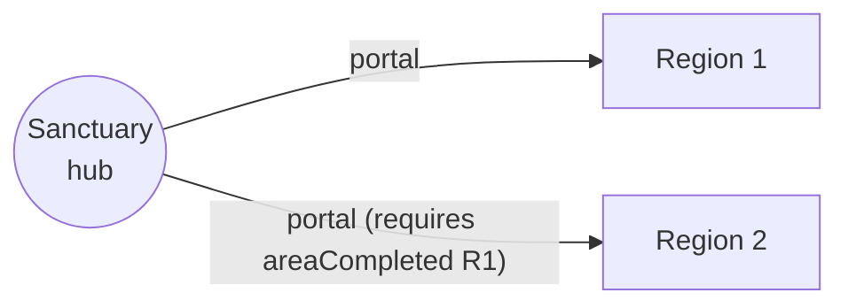

# Engine Spec: World Model (hub, world map, areas, locations)

> Status: **Draft v0.1**. Decision: [ADR-0018](../adr/0018-hierarchical-world-graph.md).

## 1. Structure

```
World
 ├─ areas[]            (world-map nodes)
 │    kind: hub | explorable | <game-defined>
 │    mapPosition, art, tags
 │    locations[] ─── exits[] (requirements) ───► locations   (area graph)
 │    completion?: CompletionRule
 │    activities?: IdleActivityRef[]  (requires completion by default)
 └─ routes[]           (world-map edges between areas, requirements, travel mode)
```

Example (RPG POC):



## 2. Content schema (engine part)

```json
{
  "id": "area:region_1",
  "kind": "explorable",
  "mapPosition": { "x": 420, "y": 310 },
  "startLocation": "loc:region_1.portal_clearing",
  "locations": ["loc:region_1.portal_clearing", "loc:region_1.old_well"],
  "completion": {
    "pool": { "tag": "ordinary" },
    "thresholdBp": 7000,
    "required": { "all": [{ "game": "defeated", "enemy": "enemy:hollow_matriarch" }] },
    "frozen": { "poolSize": 10, "requiredCount": 7, "at": "2026-12-01" }
  },
  "activities": ["idle:hunt", "idle:gather"]
}
```

```json
{
  "id": "route:sanctuary_to_region_2",
  "from": "area:sanctuary",
  "to": "area:region_2",
  "requires": { "areaCompleted": "area:region_1" },
  "travel": { "mode": "instant" }
}
```

Games extend location/area schemas with their own fields (e.g. RPG `encounters`, `resources`) through the content
compiler's schema registry; the engine ignores unknown game namespaces.

Locations may also carry an optional safe content-root-relative `scene` path to a Tiled JSON map. Geometry is compiled
into a separate bundle `scenes` map so world graph logic remains independent of renderer details.

## 3. Requirements

Closed, composable, pure:

| Predicate | Owner | Meaning |
|---|---|---|
| `all`, `any`, `not` | engine | composition |
| `discovered: loc` | engine | actor discovered location |
| `areaCompleted: area` | engine | actor completed area |
| `flag: name` | engine | actor/world flag set (story events) |
| `hasItem: { item, qty }` | engine | via economy balances |
| `{ "game": "<name>", ... }` | game | registered predicate with its own Zod schema (e.g. `defeated`, `levelAtLeast`) |

- Evaluated **server-side**; the client receives `{ unlocked, reasonKey }` per exit/route.
- The compiler validates predicate arguments and references.

## 4. Per-actor progress (engine tables)

- `area_progress (actor_id, area_id, discovered[], objectives[], completed_at?, completion_frozen_hash)`
- `world_flags (actor_id, flag)`; `world_visibility` derived (see §6).
- Completion evaluated in the same transaction as the discovery/objective event; `completed_at` is permanent.
- Game objectives (e.g. boss defeated) are recorded through `recordObjective(actor, key)` called by the game.

## 5. Travel

- POC: world-map travel is **instant** from a hub through an unlocked route; entering an explorable area creates a live
  instance at `startLocation`.
- Engine supports `travel.mode: instant | timed` (timed travel = future, could itself be a short idle-like activity).
- Leaving an area returns to the hub the route came from.

## 6. Visibility (fog of war)

Implemented by `computeWorldView` in `engine/world` (one-hop rule, so not everything connected becomes visible):

- **Reachable:** hubs, plus areas reachable from a reachable area through routes whose requirements hold.
- **Base:** hubs plus areas the actor has visited (visited, has discoveries, or completed).
- **Seen:** base areas, targets of routes leaving a base area, or areas whose optional `revealedBy` requirement holds.
- **known** = seen and reachable · **locked** = seen but not reachable (with the failing route reasons) · **hidden** = otherwise.

Within an area, undiscovered locations are hidden except as "unknown exits" from discovered ones; exits tagged
`secret` stay hidden until their target is discovered.

## 7. Validation (content compiler)

- Every area reachable from some hub under satisfiable requirements (no cycles of impossible requirements).
- Each location belongs to exactly one area; exits never cross areas (areas connect only through routes).
- Within each area: all locations reachable from `startLocation`; completion pool ≥ `requiredCount` reachable without
  `secret`-tagged exits; required objectives placeable.
- Frozen completion baselines unchanged once published.
- Generates Mermaid graphs for world map and each area.
